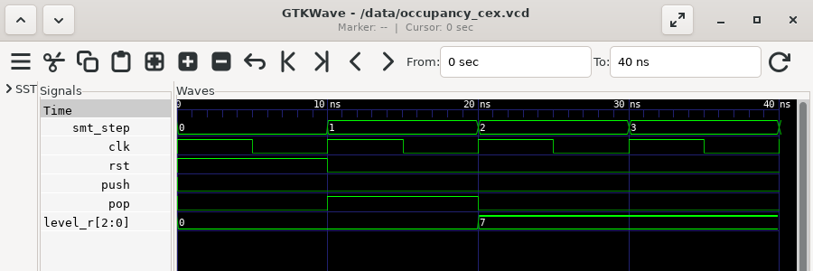

# Contracts and formal verification

<div class="chapter-goal">

You will state properties of a design with `invariant`, `requires`, `ensures` and `cover`, and prove them for every input sequence with `volt verify`. You will read a counterexample and learn when bounded checking is enough and when you need a proof.

</div>

<div class="before-you-start">

**Before you start**

- **Window:** a terminal ([how to open one](../setup.md#open-a-terminal))
  and your editor.
- **Folder:** your `volt-projects` folder. This chapter makes a new folder
  there, `formal`. **Type this:**

  ```console
  cd ~/volt-projects
  ```

- **Running:** `volt verify` needs three tools that Volt does not
  bring along: Yosys, SymbiYosys and an SMT solver.
  - **Windows:** these tools do not run on Windows by themselves. Start
    Docker Desktop and wait for **Engine running** in its window
    ([Setup](../setup.md#install-and-start-docker-desktop) shows how).
    Volt then runs the tools in a container. The container image is
    downloaded the earliest time you run `volt verify`: about 400 MB,
    which takes a few minutes.
  - **macOS and Linux:** Docker Desktop works the same way. Instead, you
    can install the tools: the YosysHQ OSS CAD Suite has all three in one
    download (`volt explain verify-setup` says where to get it).

  `volt doctor` shows how `volt verify` will run: with Docker Desktop
  running, its line reads `✓ verify — via Docker`.

</div>

The output on this page was recorded with Volt 0.1.0 in PowerShell on
Windows 11, with Docker Desktop running the tools. On macOS and Linux,
paths are written with `/` instead of `\`.

## Tests try some inputs, a proof tries all

The [counter](counter.md) chapter tested a design: the test chose the
inputs, cycle by cycle, and checked the outputs. A test shows that the
design works for those inputs. It says nothing about the inputs nobody
thought of.

A *contract* is a property written into the design itself, such as "the
level never goes above 4". *Formal verification* asks a solver, a program
that searches through every possible input sequence, whether any of them
breaks the contract. If one does, you get that input sequence as a
*counterexample*, cycle by cycle. If none does, the property holds for
every input the solver could choose.

Volt has four kinds of contract:

| Keyword | Means | May read |
|---|---|---|
| `invariant:` | always true | ports and registers |
| `requires:` | what the module expects from the module that uses it | ports |
| `ensures:` | what the module promises in return | ports |
| `cover:` | something that must be able to happen | everything |

`volt verify` checks them with formal verification. `volt test` checks
them too, while a test runs.

## A buffer with four slots

Make a folder `formal` and go into it:

**Type this:**

```console
mkdir formal
```

**Type this:**

```console
cd formal
```

The design keeps count of the items in a buffer with four slots: `push`
puts an item in, `pop` takes one out. Create the file `occupancy.volt`
(as [Setup](../setup.md#create-a-file) shows):

**Create this file:** `occupancy.volt`

```volt,file=occupancy.volt,verify=bmc:6
// Keeps count of the items in a buffer with four slots.

pub module Occupancy {
    in  clk   : clock
    in  push  : bool
    in  pop   : bool
    out level : u3
    out full  : bool
    out empty : bool

    reg level_r : u3 = 0

    on clk {
        if push && !pop {
            level_r <= level_r + 1
        } else if pop && !push {
            level_r <= level_r - 1
        }
    }

    level = level_r
    full  = level_r == 4
    empty = level_r == 0

    invariant: level_r <= 4
    cover: full
}
```

The two lines at the bottom are contracts:

- `invariant: level_r <= 4` says that the register never holds more than
  4. `level_r` has 3 bits and could hold up to 7.
- `cover: full` says that the buffer can become full. A cover is not a
  promise that something always happens, but that it can happen at all;
  [Covers](#covers-can-it-happen-at-all) below shows why that matters.

`push` and `pop` together leave the level as it is: one item goes in and
one comes out.

Check that Docker Desktop says **Engine running**, then verify the
design. This takes a few minutes the earliest time, because of the
download:

**Type this:**

```console
volt verify occupancy.volt
```

**You should see:**

```text,output
   Verifying occupancy.volt
note: SymbiYosys not found locally; running it in Docker (hdlc/formal:all)
note: downloading hdlc/formal:all (~404 MB, first use only; this can take several minutes)
note: downloaded hdlc/formal:all in 1m 18s
     [1/1] Occupancy (2 properties) ... FAIL (0.28s)
error[E5001]: contract violated
   ┌─ occupancy.volt:25:16
   │
25 │     invariant: level_r <= 4
   │                ^^^^^^^^^^^^ violated at cycle 3
   │
   = reason: the 'invariant' contract of module 'Occupancy' does not hold for every reachable state
   = counterexample: build\formal\occupancy_cex.vcd
   = help: open the counterexample with 'gtkwave' or 'surfer'
   = for more: volt explain E5001


    Finished 83.09s
    Failures:
      Occupancy.inv_0  E5001 contract violated at cycle 3
      Result 1 of 2 properties failed in 83.1s (16 jobs; bmc, depth 20)
        Next: volt explain E5001   (how to read a counterexample)
```

The two `downloading` notes appear once. This run took 83 seconds, almost
all of it for the download; the runs after it take about a second and a
half.

The invariant is violated. `volt verify` exits with code 6 and writes the
counterexample to `build\formal\occupancy_cex.vcd`. The summary line
counts two properties, the invariant and the cover, and says how the
search was made: `bmc, depth 20` means the solver looked at the 20 clock
cycles after reset (the next sections explain the other modes). `16
jobs` is the number of processor cores of the recording computer; your
number may differ.

## Read the counterexample

A counterexample is a waveform, like the ones a failing test writes.
Open it in GTKWave ([Tests and waveforms](../tour/tests-and-waveforms.md)
shows how to install it), from the `formal` folder:

**Type this (Windows, PowerShell):**

```powershell
gtkwave build\formal\occupancy_cex.vcd
```

**Type this (macOS and Linux):**

```sh
gtkwave build/formal/occupancy_cex.vcd
```

In GTKWave, open `Occupancy` in the tree at the top left and add the
signals to the view. Add `smt_step` from the top of the tree as well: it
numbers the clock cycles of the counterexample from 0.



The screenshot was taken with GTKWave 3.3.121 on Linux (Debian 13). Read
it cycle by cycle:

- **Cycle 0:** `rst` is 1. The solver always starts from reset, so
  `level_r` is 0.
- **Cycle 1:** `pop` is 1 and `push` is 0, while the buffer is empty.
- **Cycle 2:** `level_r` is 7. `0 - 1` wrapped around in 3 bits.

The invariant is checked at each clock edge, so the error names the
edge after cycle 2: cycle 3. The design itself does what it says. The
mistake is in what it allows: nothing stops a pop from an empty buffer,
or a push into a full one.

<div class="box new-to-hw">

**New to hardware?** Why a test would miss this

A test that pops an empty buffer would find this bug at once, but you
have to think of writing that test. The solver does not think about what
is sensible: it tries every input, including the ones a careful user
would never send, and here it needed two cycles to find one. That is
why formal verification is good at finding the cases nobody wrote a test
for.

</div>

## Requires and ensures

There are two ways to fix this. The design could ignore a pop from an
empty buffer. Or the module can say that it is never asked to do that,
and leave the duty to the module that uses it. That is what `requires`
is for. Replace the file:

**Replace this file:** `occupancy.volt`

```volt,file=occupancy.volt,verify=bmc,verify=cover
// Keeps count of the items in a buffer with four slots.

pub module Occupancy {
    in  clk   : clock
    in  push  : bool
    in  pop   : bool
    out level : u3
    out full  : bool
    out empty : bool

    // The module that uses Occupancy promises these.
    requires: !(push && full)
    requires: !(pop && empty)

    reg level_r : u3 = 0

    on clk {
        if push && !pop {
            level_r <= level_r + 1
        } else if pop && !push {
            level_r <= level_r - 1
        }
    }

    level = level_r
    full  = level_r == 4
    empty = level_r == 0

    invariant: level_r <= 4
    ensures: prev(push) && !prev(pop) -> !empty
    cover: full
}
```

What changed:

- `requires: !(push && full)` and `requires: !(pop && empty)`: no push
  while the buffer is full, no pop while it is empty. While `Occupancy`
  is verified, these are taken as given: the solver chooses no input that
  breaks them.
- `ensures: ... -> ...` is a promise about the outputs. `a -> b` reads
  "if `a`, then `b`". `prev(x)` is the value `x` had one cycle earlier,
  and `prev(x, 2)` two cycles earlier. The line says: after a cycle with
  a push and no pop, the buffer is not empty.

**Type this:**

```console
volt verify occupancy.volt
```

**You should see:**

```text,output
   Verifying occupancy.volt
note: SymbiYosys not found locally; running it in Docker (hdlc/formal:all)
     [1/1] Occupancy (3 properties, 2 assumed) ... ok (0.28s)
    Finished 1.54s
        Note 2 assumption(s) about the environment, not verified: Occupancy.req_0, Occupancy.req_1
      Result 3 properties verified in 1.5s (16 jobs; bmc, depth 20)
```

All three properties hold. The `Note` line lists the two `requires`:
they were assumed, not checked, because nothing in this file uses
`Occupancy`. When another module uses it, `volt verify` on that module
checks them there, as properties of the module that has to keep them.

## Covers: can it happen at all?

A `requires` that is too strict makes every check pass for a bad reason.
Suppose the upper `requires` read `requires: !push`: the solver may then
never push, the buffer stays empty, and the invariant holds, without
saying anything about a buffer that is in use. A `cover` catches this.
Verify again in cover mode:

**Type this:**

```console
volt verify --mode cover occupancy.volt
```

**You should see:**

```text,output
   Verifying occupancy.volt
note: SymbiYosys not found locally; running it in Docker (hdlc/formal:all)
     [1/1] Occupancy (3 properties, 2 assumed) ... ok (0.24s)
    Finished 1.34s
        Note 2 assumption(s) about the environment, not verified: Occupancy.req_0, Occupancy.req_1
      Result 3 properties verified in 1.3s (16 jobs; cover, depth 20)
```

In cover mode the solver searches for a way to reach each `cover` within
the depth. It found one for `cover: full`, so the buffer can fill up
while the `requires` hold. With `requires: !push` in place of the upper
`requires`, the same command reports the cover as an error:

**You should see (with `requires: !push`):**

```text,output

```

In cover mode the error means "not reached within the depth": the solver
searched the 20 cycles of the depth and found no way to make `full`
true; the cycle in the message is the last one it searched. The words
of the message are the ones used for a broken property ("violated",
"does not hold"), and no counterexample file is written, although the
help line names one; `volt explain E5001` describes both modes. Run
`--mode cover` whenever you add or change a `requires`.

## Twenty cycles, or every cycle

So far `volt verify` ran in its default mode, `bmc` (bounded model
checking): the solver looked for a counterexample within 20 cycles after
reset. That is enough for `Occupancy`, which reaches each of its levels
within a few cycles. It is not enough for a design that needs more
cycles to go wrong.

This module gives a pulse every 25 cycles, and has a bug: it counts to
25 instead of 24, so the count reaches 25 for one cycle. Create
`divider.volt`:

**Create this file:** `divider.volt`

```volt,file=divider.volt,verify=bmc,verify=prove:7,verify=bmc@30:6
// Gives a one-cycle tick every 25 clock cycles.

pub module Divider {
    in  clk  : clock
    out tick : bool

    reg count_r : u5 = 0

    on clk {
        if count_r == 25 {
            count_r <= 0
        } else {
            count_r <= count_r + 1
        }
    }

    tick = count_r == 24

    invariant: count_r < 25
}
```

**Type this:**

```console
volt verify divider.volt
```

**You should see:**

```text,output
   Verifying divider.volt
note: SymbiYosys not found locally; running it in Docker (hdlc/formal:all)
     [1/1] Divider (3 properties) ... ok (0.32s)
    Finished 1.68s
      Result 3 properties verified in 1.7s (16 jobs; bmc, depth 20)
```

Every property holds, because the count reaches 25 after more than 20
cycles. The design has three properties although you wrote one: for a
counter, Volt adds an upper bound and a cover of its wrap by itself.

A passing `bmc` run says: no counterexample within 20 cycles. To know
about every cycle, ask for a proof:

**Type this:**

```console
volt verify --mode prove divider.volt
```

**You should see:**

```text,output
   Verifying divider.volt
note: SymbiYosys not found locally; running it in Docker (hdlc/formal:all)
     [1/1] Divider (3 properties) ... unknown (0.33s)
error[E5002]: contract not proven: the induction step failed
   ┌─ divider.volt:19:16
   │
19 │     invariant: count_r < 25
   │                ^^^^^^^^^^^^ not inductive at depth 20
   │
   = reason: no counterexample exists within 20 cycles from reset, but the induction step starts from an arbitrary state — possibly unreachable — and the 'invariant' contract of module 'Divider' fails from there (sby status UNKNOWN)
   = note: induction trace (may start from an unreachable state): build\formal\divider_induct.vcd
   = help: try a larger --depth, or add an invariant that makes the property inductive
   = for more: volt explain E5002


    Finished 1.35s
    Failures:
      Divider.inv_0  E5002 not proven (induction step failed)
      Result 0 of 3 properties failed, 1 not proven in 1.4s (16 jobs; prove, depth 20)
        Next: volt explain E5002   (why a true property can fail induction)
```

`--mode prove` uses *induction*: if the property held for 20 cycles in a
row, starting anywhere, does it hold in the next one? Here it does not,
so the proof fails, and the command exits with code 7, "not proven". That
is not yet a bug: the solver may have started from a state the design
can never reach. The help line names the two ways on. A larger depth
looks further:

**Type this:**

```console
volt verify --depth 30 divider.volt
```

**You should see:**

```text,output
   Verifying divider.volt
note: SymbiYosys not found locally; running it in Docker (hdlc/formal:all)
     [1/1] Divider (3 properties) ... FAIL (0.36s)
error[E5001]: contract violated
   ┌─ divider.volt:19:16
   │
19 │     invariant: count_r < 25
   │                ^^^^^^^^^^^^ violated at cycle 27
   │
   = reason: the 'invariant' contract of module 'Divider' does not hold for every reachable state
   = counterexample: build\formal\divider_cex.vcd
   = help: open the counterexample with 'gtkwave' or 'surfer'
   = for more: volt explain E5001


    Finished 1.42s
    Failures:
      Divider.inv_0  E5001 contract violated at cycle 27
      Result 1 of 3 properties failed in 1.4s (16 jobs; bmc, depth 30)
        Next: volt explain E5001   (how to read a counterexample)
```

Now `bmc` finds the bug, at cycle 27. Fix the comparison,
`count_r == 24`:

**Replace this file:** `divider.volt`

```volt,file=divider.volt,verify=prove
// Gives a one-cycle tick every 25 clock cycles.

pub module Divider {
    in  clk  : clock
    out tick : bool

    reg count_r : u5 = 0

    on clk {
        if count_r == 24 {
            count_r <= 0
        } else {
            count_r <= count_r + 1
        }
    }

    tick = count_r == 24

    invariant: count_r < 25
}
```

**Type this:**

```console
volt verify --mode prove divider.volt
```

**You should see:**

```text,output
   Verifying divider.volt
note: SymbiYosys not found locally; running it in Docker (hdlc/formal:all)
     [1/1] Divider (3 properties) ... ok (0.31s)
    Finished 1.40s
      Result 3 properties verified in 1.4s (16 jobs; prove, depth 20)
```

Proved: the invariant holds in every cycle, however long the design
runs. When to use which mode:

- **`bmc`** (the default) finds bugs that happen within `--depth` cycles
  of reset, and gives a counterexample. It is enough when the design
  reaches all of its states within that depth.
- **`--mode prove`** shows that a property holds forever. Use it for
  counters, timers and anything else that takes many cycles to come back
  to where it started. When it says "not proven", try a larger
  `--depth`, or add an `invariant` that rules out the states the
  solver started from.
- **`--mode cover`** shows that the covers can be reached, so that a
  passing proof is not passing because nothing can happen.

You are in the `formal` folder.

<div class="box from-sv">

**Coming from SystemVerilog?** Contracts become SVA

`volt build --emit=sva` writes the contracts as SystemVerilog
assertions in `build/formal/`, in a checker module with a `bind`. An
`invariant` becomes an `assert property` with `@(posedge clk) disable
iff (rst)`, a `requires` becomes an `assume property` while the module
itself is verified, `prev(x, N)` becomes `$past(x, N)`, and `a -> b`
becomes `a |-> b`. `volt verify` writes the SymbiYosys script for you
and maps a failure back to the line of the contract. There are no
sequences (`##`) and no liveness properties; see
[Known limitations](../limitations.md#formal-verification).

</div>

## What we learned

- `invariant`, `requires`, `ensures` and `cover` are written into the
  module; `prev(x)` reads the value of the previous cycle, `a -> b` reads
  "if a, then b".
- `volt verify` exits with code 6 and writes a counterexample waveform
  when a contract can be broken; read it cycle by cycle.
- A `requires` is assumed while its module is verified and checked
  where the module is used.
- `--mode cover` shows that the covers can happen, so a too strict
  `requires` does not go unnoticed.
- `bmc` looks `--depth` cycles deep; `--mode prove` covers every cycle,
  and says "not proven" (code 7) when induction is not enough.

Next: the chapters after this one in the Tutorial are planned. The
Cookbook has recipes that build on this chapter and the previous one,
such as [Reset synchronizers](../cookbook/reset-sync.md).
